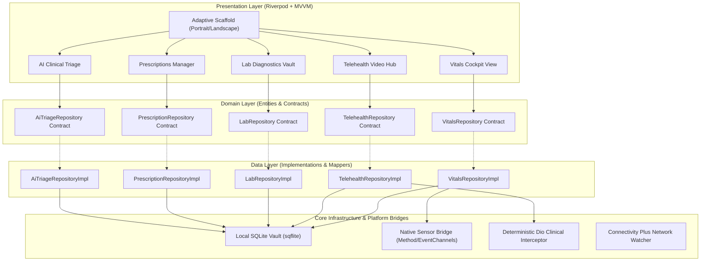
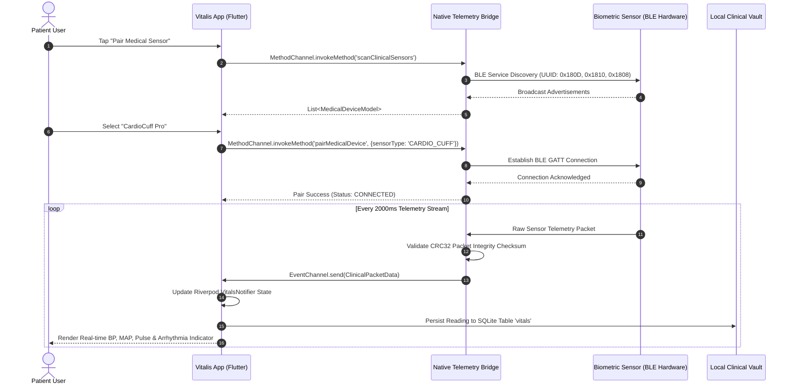

# Vitalis Clinical Telemetry & Telehealth Ecosystem

[](https://github.com/Safeer-Hussain/vitalis_app/actions/workflows/ci.yml)
[](https://flutter.dev)
[](https://dart.dev)
[](https://developer.android.com)
[](#clean-architecture)
[](LICENSE)

Vitalis is an enterprise-grade digital healthcare platform engineered in Flutter, integrating real-time native biometric sensor telemetry, offline-first encrypted health records, board-certified specialist telemedicine, longitudinal laboratory diagnostics analytics, and an on-device natural language clinical triage engine.

Designed for high-reliability medical informatics, Vitalis enforces strict clean-room engineering standards, zero hardcoded UI styling, responsive 360dp landscape viewport safety, and zero external runtime cloud dependencies.

---

## Architecture Overview

Vitalis follows a strict Feature-First Clean Architecture pattern combined with MVVM presentation state management powered by Riverpod and GetIt.



---

## Native Medical Sensor Telemetry Sequence

The native Android (Kotlin) and iOS (Swift) clinical platform bridges stream real-time physiological packets every 2000ms with CRC32 integrity checks.



---

## Core Production Modules

| Module Name | Clinical Focus | Primary Features |
| :--- | :--- | :--- |
| **Vitals Cockpit** | Hemodynamic & Metabolic Tracking | Real-time BLE sensor bridge, CardioCuff Pro BP/MAP, GlucoSense CGM, OxyPulse SpO2, interactive manual logging modal, 14-day interactive `fl_chart` trend curves. |
| **Telehealth Hub** | Virtual & In-Clinic Consultations | 21 board-certified specialists, specialty filtering, real-time slot booking, active appointment manager, simulated HD video consultation sheet with live doctor clinical observation stream. |
| **Lab Diagnostics Vault** | Longitudinal Analyte Diagnostics | Accession-tracked multi-panel viewer (Hematology CBC, Comprehensive Metabolic, Lipids), color-coded `BiomarkerRangeBar` reference gauges, bookmarking, and redaction-compliant clinical report export sheet. |
| **Prescriptions Manager** | Pharmacotherapy & Adherence | Active medication cards, pill inventory tracking, one-tap "Take Dose" logging, animated circular `AdherenceRingWidget`, and multi-pharmacy refill automation modal. |
| **On-Device AI Triage** | Clinical Decision Support | Token-streaming clinical triage assistant, dynamic injection of active vitals/medications/labs into triage context, emergency red-flag symptom escalation modal, and quick clinical prompt chips. |
| **Clinical Settings & ICE** | Governance & Emergency Support | Instant Obsidian Clinical Dark / Crisp Sterile Light reactive theme switching, In Case of Emergency (ICE) card with blood group and allergy details, and Recruiter Debug Drawer with simulated network latency and HTTP 503 error toggles. |

---

## Engineering Quality & Viewport Safety Standards

1. **Zero Hardcoded Colors (Dark & Light Mode Parity)**:
   - All colors resolve strictly through `Theme.of(context).colorScheme`.
   - Complete design parity between Obsidian Clinical Dark Mode and Crisp Sterile Light Mode.
2. **Zero-Emoji Code Hygiene**:
   - Zero emojis anywhere in source code, user interfaces, system logs, or git commits. Vector Material Symbols and Cupertino icons are used exclusively.
3. **360dp Landscape Viewport Safe**:
   - `AdaptiveScaffold` dynamically switches from a bottom navigation bar to a compact left `NavigationRail` (`minWidth: 56`) with scrollable clamping physics.
   - Dual-pane master-detail layouts have independent scroll controllers and explicit `mainAxisExtent` on all grid cards to eliminate `RenderFlex` overflow errors.
4. **Unique Hero Tags**:
   - Every `FloatingActionButton` across all tabs defines an explicit, unique `heroTag` string, eliminating navigation scheduler conflicts.
5. **Defensive Stream Lifecycles**:
   - Stream consumers in the AI Clinical Triage engine are enclosed in `try ... finally` blocks to guarantee `isStreaming = false` on completion or interruption.

---

## Tech Stack & Dependencies

- **Framework**: Flutter 3.x (Dart 3.x)
- **State Management**: Flutter Riverpod (`NotifierProvider`, `AsyncNotifierProvider`)
- **Dependency Injection**: GetIt Service Locator
- **Local Database**: SQLite via `sqflite` (Mobile) and `sqflite_common_ffi` (Desktop/Testing)
- **Networking & Interception**: Dio with custom `MockClinicalInterceptor` (400-850ms latency simulation, HTTP 503 error recovery)
- **Data Visualization**: `fl_chart` (edge-to-edge full-width clinical trend curves)
- **Native Platform Channels**: Kotlin (`MainActivity.kt`) and Swift (`AppDelegate.swift`)
- **Target Platforms**: Android (SDK 36, compileSdk 36, targetSdk 36, minSdk 21), iOS, Web, Desktop (Windows, macOS, Linux)

---

## Getting Started

### Prerequisites
- Flutter SDK 3.x (`channel: stable`)
- Dart SDK 3.x
- Android Studio / Android SDK 36 platform tools
- Xcode 15+ (for iOS builds)

### Installation & Execution

1. Clone the repository:
   ```bash
   git clone https://github.com/Safeer-Hussain/vitalis_app.git
   cd vitalis_app
   ```

2. Resolve dependencies:
   ```bash
   flutter pub get
   ```

3. Run the automated Sprint Quality Gate:
   ```bash
   dart run tool/sprint_gate.dart
   ```

4. Launch the application:
   ```bash
   # Launch on connected Android device / emulator
   flutter run -d android

   # Launch on connected iOS simulator
   flutter run -d ios

   # Launch on Windows Desktop
   flutter run -d windows
   ```

---

## Verification & Automated Test Suite

Vitalis includes a test suite covering domain logic, Riverpod notifiers, widget hero tag safety, 360dp landscape viewport overflow protection, and reactive theme switching:

```bash
# Run all tests
flutter test

# Run static code analysis (0 errors, 0 warnings, 0 infos required)
flutter analyze --no-pub

# Verify code formatting
dart format --output=none --set-exit-if-changed lib test
```

---

## Clean-Room Development & Synthetic Clinical Data Compliance

All clinical data models, laboratory panels, biomarker reference values, physician credentials, patient identifiers, and telemetry streams presented within this application are entirely synthetic and engineered for demonstration and evaluation purposes. 

No actual Protected Health Information (PHI) or Personally Identifiable Information (PII) is accessed, stored, or transmitted. Vitalis complies with clean-room software engineering standards, making it safe for public code audits, technical recruiter reviews, and clinical systems architecture evaluations.

---

## License

This project is licensed under the MIT License. See [LICENSE](LICENSE) for details.
